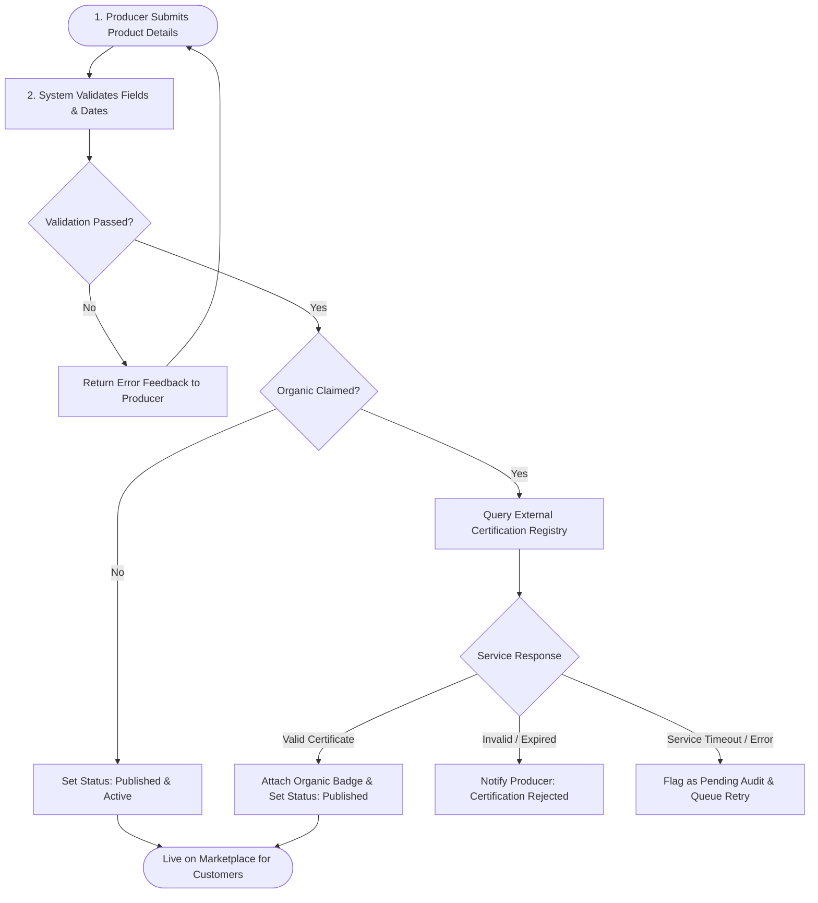

# Use Case 1: Analysis of Major Business Processes and Organisational Responsibilities

## 1. System Overview & Scope

In the context of the Distributed and Enterprise Software Development platform, **Use Case 1 (Producer Product Listing and Inventory Management)** establishes the foundational supply-side operations. The primary objective is to allow registered agricultural producers to introduce goods into the marketplace catalog, maintain accurate real-time inventory counts, verify statutory and organic claims, and automate catalog visibility based on harvest seasonality and stock levels.

This analysis details the operational lifecycle of a product from initial submission to customer availability and automated stock depletion. It defines the procedural steps, validation checkpoints, external dependency behaviors, and the explicit distribution of responsibilities across organizational roles and automated system components.

---

## 2. Participating Entities and System Actors

To establish clear enterprise boundaries, the operations within this use case interact across four distinct entities:

| Entity / Actor | Type | Operational Role & Boundary |
| :--- | :--- | :--- |
| **Registered Producer (Farmer / Supplier)** | Human Actor | Authenticated vendor responsible for data entry, stock figure declaration, harvest dates, and certification claims. |
| **Marketplace Platform (Core Services)** | Software Subsystem | Orchestrates submission ingestion, schema validation, state transitions, catalog indexing, and automated availability rules. |
| **Organic Certification Authority (Service / API)** | External Dependency | Third-party or simulated verification provider (e.g., Soil Association standard registry) validating organic licensing credentials. |
| **Marketplace Quality & Compliance Officer** | Human Actor (Internal) | Administrative staff responsible for handling certification audit exceptions, disputes, or manual verification fallbacks. |

---

## 3. High-Level Process Architecture

The following workflow diagram illustrates the lifecycle flow of product onboarding, validation gateways, third-party verification, and public listing:

---

## 4. In-Depth Analysis of the Six Major Business Processes

### Process 1: Product Submission
* **Objective:** Capture complete agricultural, commercial, and traceability attributes from the producer.
* **Trigger:** An authenticated producer accesses their vendor dashboard and submits the "New Product Listing" form.
* **Required Data Attributes:**
  * *Commercial Details:* Product title, detailed description, general category (e.g., Vegetables, Dairy, Orchard Fruits), unit base price (£ GBP), unit of measure (kg, bundle, litre).
  * *Inventory & Batch Data:* Initial physical quantity on hand, harvest batch identifier, harvest date, and best-before date.
  * *Origin & Traceability Details:* Farm name, registered physical location/coordinates, and mandatory allergen flags (e.g., celery, nuts, gluten).
  * *Compliance Data:* Organic declaration checkbox and Organic Certificate License Number (if applicable).
  * *Seasonality Window:* Scheduled availability start date and scheduled end date.
* **Outcome:** A persistent draft entity is instantiated within the platform database with the state `SUBMITTED`.

### Process 2: Product Validation
* **Objective:** Ensure data integrity, business constraint adherence, and sanitization prior to catalog persistence.
* **Trigger:** Successful submission of the product payload.
* **System Rules & Checks:**
  1. *Completeness Check:* Ensure mandatory fields (Name, Category, Price, Quantity, Origin, Best-Before Date) are non-null.
  2. *Numeric Bounds Check:* Verify that base price > £0.00 and declared inventory is an integer $\ge 1$.
  3. *Date Logic Validation:* Verify that `Harvest Date` $\le$ `Current Date` and `Best-Before Date` $>$ `Current Date`. Confirm that `Seasonality Start Date` $<$ `Seasonality End Date`.
* **Branching & Exception Flow:**
  * *Failure:* If any rule fails, the transaction is rejected. The system returns targeted field-level error messages back to the producer's interface without committing the record.
  * *Success:* If all structural checks succeed, the record advances to state `VALIDATED`.

### Process 3: Organic Certification Verification
* **Objective:** Safeguard customer trust and legal compliance by verifying authentic organic status through external registry validation.
* **Trigger:** Product flagged with `is_organic = true` passing initial validation.
* **Execution Logic:**
  1. The marketplace dispatches an outbound query containing the producer's registered business identity and certificate reference to an external (or simulated) Certification Authority service.
  2. **Scenario A (Valid Certificate):** The service returns an affirmative confirmation and validity expiration date. The marketplace assigns the official "Organic Verified" badge and timestamps the audit log.
  3. **Scenario B (Invalid / Expired Certificate):** The service rejects the license identifier. The product is prevented from listing as organic. The producer receives a notice explaining that the product must either be listed as conventional produce or supported by updated certification documentation.
  4. **Scenario C (Third-Party Service Unavailable / Network Timeout):** In the event of network dropouts or upstream 5xx errors, the transaction must not crash the listing pipeline. Instead, the product enters a `PENDING_AUDIT` holding queue with an exponential backoff retry worker. If the service remains unreachable after three automated retries, a notification is routed to the Marketplace Compliance Officer for manual verification.

### Process 4: Product Publication
* **Objective:** Make validated goods discoverable and orderable within the customer-facing storefront.
* **Trigger:** Successful completion of validation and any required compliance checks.
* **Workflow:**
  1. Product operational state transitions from `VALIDATED` to `ACTIVE_LISTED`.
  2. The catalog search index is updated, exposing the item to customer search, category filtering, and direct links.
  3. An automated confirmation receipt is pushed to the producer's notification center.

### Process 5: Inventory Management
* **Objective:** Maintain continuous, atomic inventory tracking to prevent over-selling and ensure stock transparency.
* **Operational Mechanics:**
  * *Decrement on Purchase:* As customer checkouts are confirmed (connected downstream to Use Case 2), the inventory engine decrements the available stock count using transactional database locks to avoid race conditions.
  * *Zero-Stock Depletion Trigger:* When the available count reaches exactly `0`, the system automatically changes the catalog flag to `OUT_OF_STOCK` and suppresses the item from active customer shopping baskets.
  * *Stock Replenishment Flow:* When a producer harvests a new batch or updates stock figures via the portal, the quantity is updated. The system evaluates whether the current calendar date remains within the seasonal availability window. If valid, the product state automatically reverts to `ACTIVE_LISTED`.

### Process 6: Seasonal Availability Management
* **Objective:** Align product discoverability with natural agricultural growth cycles and producer-defined seasonal constraints.
* **Operational Mechanics:**
  * *Temporal Boundary Enforcement:* Each product possesses a seasonal period bounded by `start_date` and `end_date`.
  * *Automated Batch Scheduler:* A scheduled background service evaluates catalog entries daily at 00:00 UTC.
  * *Out-of-Season Suspension:* If `Current Date` $>$ `end_date`, the product status transitions to `SEASONAL_SUSPENSION`. Even if physical stock remains recorded in the database, the item cannot be purchased by customers.
  * *In-Season Activation:* When the calendar enters the active window (`Current Date` $\ge$ `start_date`), eligible products with positive stock counts are automatically activated into the live catalog.

---

## 5. Product Lifecycle Status Stages (Visual State Transitions)

A product moves through distinct lifecycle stages governed by automated system rules, sales activity, and calendar dates:

| Current Status | Trigger Event / Condition | Automated Platform Action | Resulting Status |
| :--- | :--- | :--- | :--- |
| **`DRAFT`** | Producer enters listing information | Form data held in staging; awaiting validation | ➡️ **`VALIDATED`** *(Checks pass)* |
| **`VALIDATED`** | Schema valid & Organic credentials confirmed | Catalog engine indexes product into public search | ➡️ **`ACTIVE & PUBLISHED`** |
| **`ACTIVE & PUBLISHED`** | Customer checkout decrements final inventory unit | Stock reaches exactly `0`; item suppressed from search | ➡️ **`OUT OF STOCK`** |
| **`OUT OF STOCK`** | Producer declares new harvest batch quantity | System verifies current calendar is within season | ➡️ **`ACTIVE & PUBLISHED`** |
| **`ACTIVE & PUBLISHED`** | Calendar date exceeds declared harvest window | Midnight automated scheduler flags season expired | ➡️ **`SEASONAL PAUSE`** |
| **`SEASONAL PAUSE`** | Current date re-enters active seasonal window | System verifies stock > 0 and restores catalog listing | ➡️ **`ACTIVE & PUBLISHED`** |

---

## 6. Organisational Responsibility Matrix (RACI Framework)

To clarify accountability across the enterprise, each phase of Use Case 1 is mapped against the **RACI** model:
* **R (Responsible):** The role that executes the task.
* **A (Accountable):** The individual or entity with final decision ownership.
* **C (Consulted):** Two-way communication providers or external authorities.
* **I (Informed):** Entities notified of status updates.

| Business Process / Activity | Producer (Farmer) | Marketplace Automated Engine | External Certification Authority | Marketplace Compliance Officer |
| :--- | :---: | :---: | :---: | :---: |
| **1. Initial Product Data Entry** | **R / A** | I | N/A | N/A |
| **2. Field Validation & Schema Verification** | I | **R / A** | N/A | N/A |
| **3. Organic Claim Submission** | **R** | I | C | N/A |
| **4. Organic Credential Verification** | N/A | R | **C / A** | I |
| **5. Verification Exception / Downtime Triage** | I | R | C | **A** |
| **6. Catalog Publication & Indexing** | I | **R / A** | N/A | N/A |
| **7. Real-Time Stock Decrement & Zero Trigger** | N/A | **R / A** | N/A | N/A |
| **8. Stock Restocking / Quantity Revision** | **R / A** | I | N/A | N/A |
| **9. Seasonal Schedule Monitoring & Suspension** | I | **R / A** | N/A | N/A |

---

## 7. Failure Handling and Edge Case Protocols

Enterprise systems must remain resilient against edge cases. Use Case 1 incorporates three specific failure-handling procedures:

1. **External Verification Service Outage:**
   * *Risk:* Third-party verification endpoint times out or returns HTTP 503.
   * *Mitigation:* The product is not rejected. It is flagged as `AWAITING_VERIFICATION`. The platform continues to permit submission of non-organic goods while placing the organic claim into a non-blocking background queue. The producer is notified that their listing is under review rather than receiving an unhandled error.

2. **Negative Inventory Race Conditions:**
   * *Risk:* Concurrent customer checkouts attempt to claim the final unit of stock simultaneously.
   * *Mitigation:* The inventory subsystem employs atomic updates (`UPDATE products SET stock = stock - qty WHERE id = ? AND stock >= qty`). If the query returns zero affected rows, the transaction rolls back, preventing negative inventory balances.

3. **Mid-Season Premature Crop Failure:**
   * *Risk:* An environmental event destroys a producer's harvest prior to the declared seasonal end date.
   * *Mitigation:* The producer maintains administrative override privileges to force-trigger immediate `MANUAL_UNLISTING` or set inventory count to zero without waiting for scheduled seasonal expiration dates.

---

## 8. Summary for Sprint 1 Delivery

This analysis fulfills the Sprint 1 enterprise analysis requirements for Use Case 1 by establishing:
* A thorough decomposition of all six business processes.
* Clear operational boundaries between human actors, internal platform microservices, and external certification partners.
* A structured RACI governance matrix defining organizational accountability.
* Concrete exception pathways for verification downtime, inventory depletion, and seasonal lifecycle constraints.
